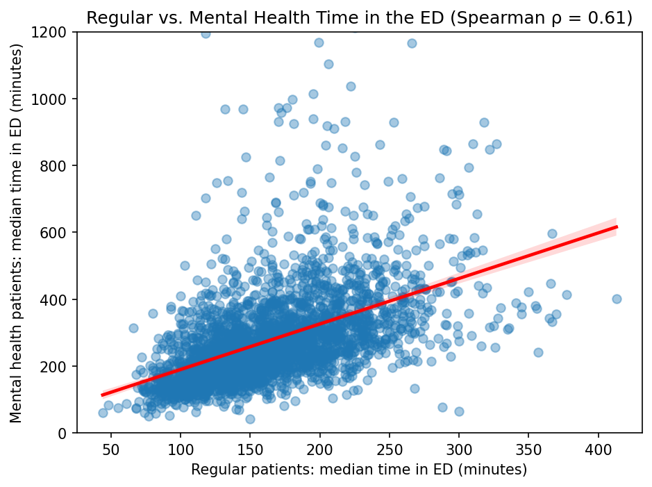
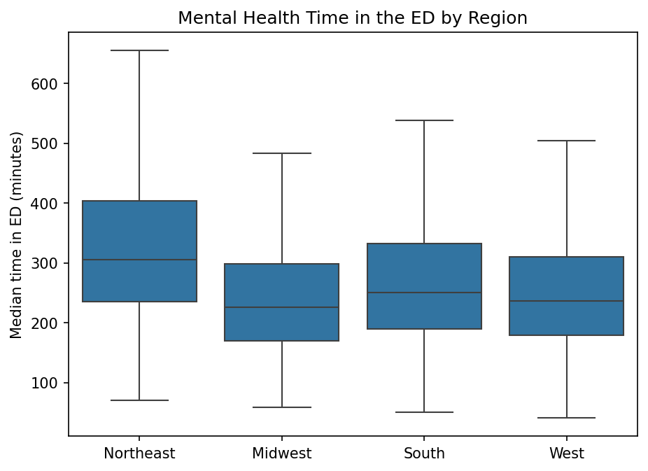
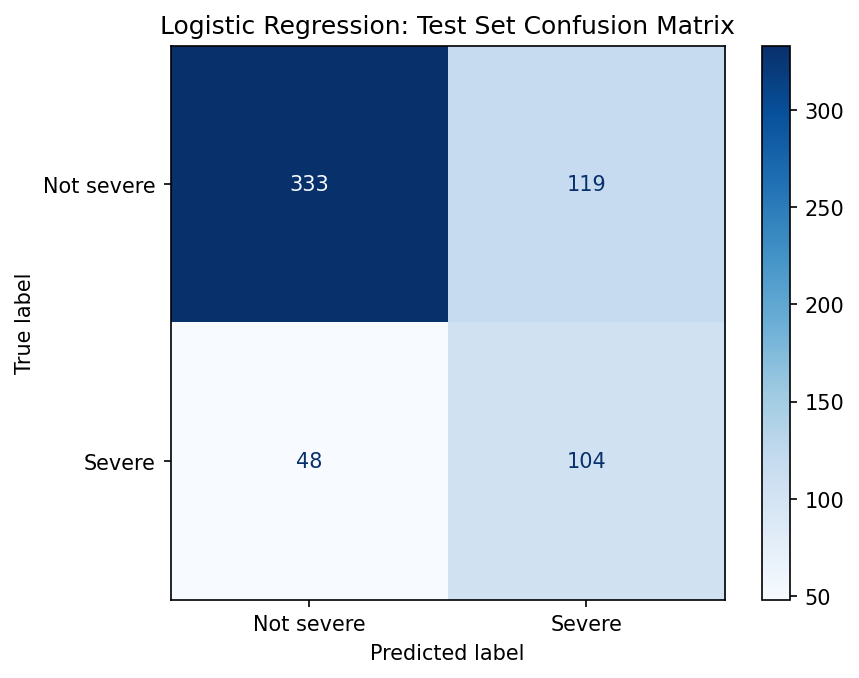

# Psychiatric ED Length of Stay: What Predicts the Longest Stays?

**Author:** Wanjiru Randolph · M.S. Applied Statistics & Data Science, University of Texas at Arlington
**Tools:** SQL (DuckDB, jupysql), Python (pandas, scikit-learn, statsmodels, matplotlib, seaborn)

## Project overview
Mental health patients can spend many hours in the emergency department (ED), and some
hospitals are much slower than others. CMS tracks ED length of stay as a quality measure
because crowded EDs are linked to delays in care, and its measure specification states that
"reducing the time patients remain in the emergency department can improve access to
treatment" ([CMS measure CMS32](https://ecqi.healthit.gov/sites/default/files/ecqm/measures/CMS32v8.html)).
CMS reports psychiatric/mental health patients separately (OP-18c), which makes it possible
to compare hospitals on this group specifically.

This project uses public CMS data to find which hospital characteristics are linked to the
longest ED stays for mental health patients, and what that could mean for hospital administrators.

## Research question
**Which hospital characteristics predict the longest ED stays for mental health patients?**

"Longest" is defined as the top 25% of hospitals (324+ minutes), so the task is binary
classification: severe vs. not severe.

## Dataset
Public data from the CMS Provider Data Catalog:
- [Timely and Effective Care – Hospital](https://data.cms.gov/provider-data/dataset/yv7e-xc69):
  ED measures OP-18b, OP-18c, and EDV (ER volume)
- [Hospital General Information](https://data.cms.gov/provider-data/dataset/xubh-q36u):
  hospital type, ownership, state, star rating, and quality "Worse" counts

**What is measured:**
- `wait_psych` = **OP-18c:** median time psychiatric/mental health patients spend in the ED,
  from arrival to departure, among patients discharged from the ED. Admitted patients are not
  included, so this is **ED length of stay, not boarding time**.
- `wait_regular` = **OP-18b:** the same measure for ED patients, excluding psychiatric/mental
  health patients and patients transferred to another facility.

**Time period:** OP-18 measures cover October 1, 2024 – September 30, 2025; ER volume (EDV)
covers calendar year 2024.

**Size:** 4,658 hospitals in the combined dataset; **3,018** report the mental health ED measure
and are used in the analysis.

## Data preparation
- **SQL:** joined the ED measures, ER volume, and hospital information into one hospital-level
  table (3 joins), reading values as text and converting with `TRY_CAST` to handle "Not Available."
- **Missing values:** replaced "Not Available" with blanks. 1,635 hospitals had no mental health
  ED score. Every one has a CMS footnote explaining why, and most (61%) had too few mental health
  ED cases to report ([footnote definitions](https://ahd.com/definitions/qual_hqi_footnotes.html)).
  Remaining blanks in numeric features are filled with the training-set median after the
  train/test split, to avoid leakage.
- **Duplicates:** checked that each hospital appears only once.
- **Other choices:** dropped columns not needed (contact information, footnotes, CMS sample
  sizes), dropped 5 territory hospitals, grouped states into 4 U.S. Census regions, grouped
  ownership into Non-profit / Government / For-profit, and labeled missing ER volume as "Unknown."
- **Leakage check:** the CMS star rating includes OP-18b but not OP-18c, so star rating does not
  contain the target ([star rating methodology summary](https://blog.medisolv.com/articles/2025-star-ratings-calculation)).

## Methods
- **SQL (DuckDB):** built the analysis dataset from the raw CMS files
- **Visualizations:** histograms, box plots, a scatter plot, and a correlation heatmap to compare
  ED stays by hospital type, ER volume, ownership, region, and star rating before modeling.
- **Spearman correlation:** rank-based, so it handles outliers and features with only a few
  values (like the "Worse" counts).
- **Binary target (top 25% = severe):** CMS treats a lower median ED time as better
  ([measure specification](https://ecqi.healthit.gov/sites/default/files/ecqm/measures/CMS32v8.html)),
  so hospitals at the high end are the ones of most concern. "Severe" means above the 75th
  percentile (324+ minutes), the same "worst-performing quartile" cut CMS uses in its
  [Hospital-Acquired Condition Reduction Program](https://www.cms.gov/medicare/quality/value-based-programs/hospital-acquired-conditions).
  CMS does not set this cutoff for OP-18 itself; applying it here is my modeling choice. 
- **Logistic regression:** interpretable. Odds ratios show which characteristics are linked to
  severe stays and in which direction, which answers the research question directly.
- **`class_weight="balanced"`:** only 25% of hospitals are severe, so without it the model would
  lean toward "not severe" and miss many severe hospitals.
- **Baseline that always predicts "not severe":** shows what no learning looks like. It is 75%
  accurate but finds no severe hospitals, which is why accuracy alone is misleading here.
- **80/20 stratified split + 5-fold cross-validation:** checks the model on hospitals it hasn't
  seen and how stable the results are; the test set was used only once, at the end.
- **Recall, precision, and AUC:** recall shows how many severe hospitals are found, precision how
  many flagged hospitals are truly severe, and AUC how well the model separates the two groups.
- **statsmodels for confidence intervals:** scikit-learn doesn't report p-values, so the same
  model was refit to see which odds ratios are statistically significant.
- **Model with and without regular ED time:** regular ED time dominated the model, so removing it
  shows which characteristics matter only because they are linked to overall ED flow.

## Key findings
1. **Overall ED flow is the strongest predictor.** About 51 more minutes of regular ED time is
   linked to about **3× the odds** of a severe mental health ED stay (OR = 3.06, 95% CI 2.63–3.55).
2. **Hospital characteristics matter mainly through ED flow.** Without regular ED time, higher ER
   volume, the Northeast, and Acute Care hospitals are significantly linked to severe stays. With
   it, none remain significant. Star rating and quality scores were not significantly linked either way.
3. **The model finds about two-thirds of the worst hospitals** using only public data
   (test set: recall 0.68, precision 0.47, AUC 0.80, vs. a baseline with recall 0 and AUC 0.50).
   Test results matched cross-validation, so the model is not overfitting.

*Hospitals where regular ED patients stay longer also tend to keep mental health patients longer
(Spearman ρ = 0.61).*

*The Northeast has the longest mental health ED stays, but region is no longer significant once
regular ED time is in the model.*

*On 604 test hospitals, the model caught 104 of 152 severe hospitals; 104 of the 223 it flagged
were truly severe.*

**What this could mean for hospitals:**
- **Look at overall ED flow first.** Slow EDs for everyone go with the longest mental health stays,
  so improving overall flow may also help these patients.
- **Don't rely on star ratings** to spot this problem; track mental health ED time directly.
- **Screen and prioritize:** public data alone can flag hospitals likely to have severe stays, to
  help decide where to look more closely.

## Limitations
- Association, not cause.
- Only hospitals that report the measure are included. Small and rural hospitals are
  underrepresented, the model can't be evaluated for non-reporting hospitals, and performance was
  not checked separately for the Critical Access hospitals that do report.
- One time period; no psychiatric bed capacity, hospital finance, or community income data.

## Next steps
- Add other ED crowding measures, such as patients who leave without being seen (OP-22)
- Add psychiatric bed capacity data and multiple years of CMS data
- Add hospital financial data or community income by ZIP code
- Set the decision threshold to keep recall at 70% or higher, then maximize precision. Too many false alarms can cause alert fatigue, where staff may start ignoring flags. The cutoff would be chosen with cross-validation on the training data and confirmed once on the test set.
- Try a more flexible models, such as gradient boosting, to check for patterns logistic regression may miss 

## How to run
1. Download the two CMS files above into `data/raw/` (raw and processed data are not stored in this repo).
2. Run the notebooks in order:
   - `notebooks/1. SQL_Dataset.ipynb`: builds the dataset
   - `notebooks/2. Data Preprocessing and EDA.ipynb`: cleaning, EDA, feature engineering
   - `notebooks/3. Modeling.ipynb`: baseline, logistic regression, interpretation
3. Install the packages:
   `pip install pandas numpy matplotlib seaborn scikit-learn statsmodels duckdb duckdb-engine jupysql`
